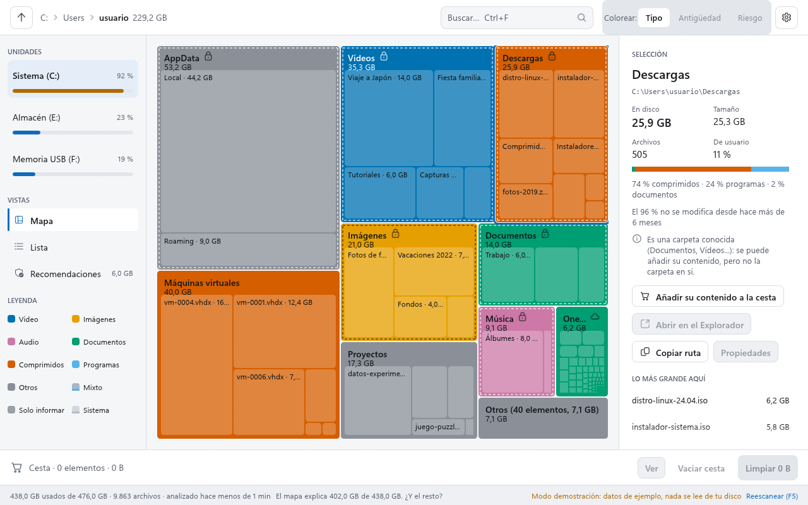
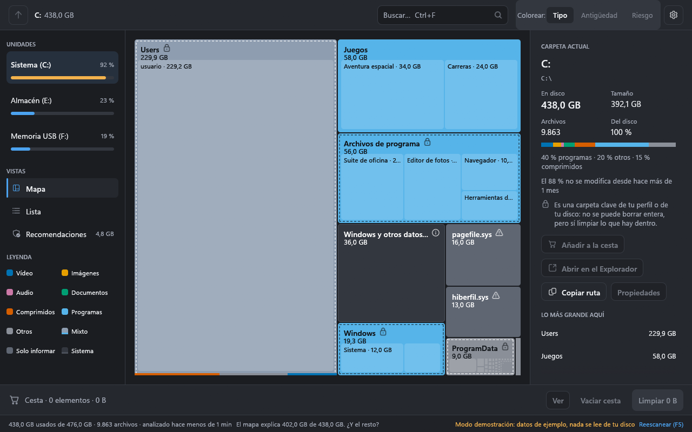
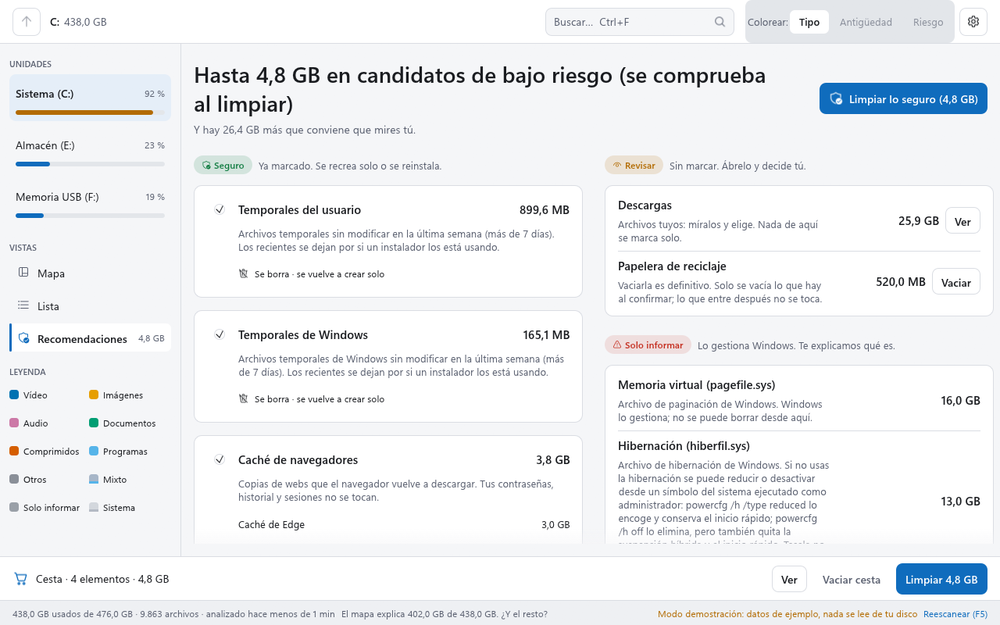
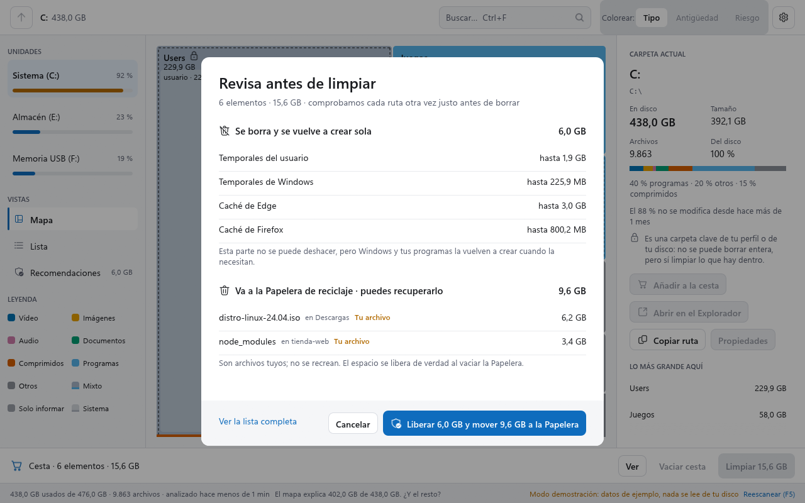
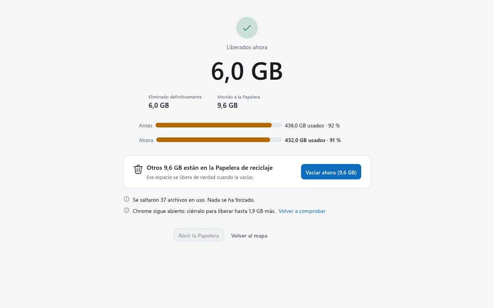

# Tesela

**Mira qué ocupa tu disco y libera espacio sin miedo.**
Analizador visual de espacio en disco para Windows, escrito en Rust: rápido, ligero y claro.

[Instalación](#instalación) · [Code signing policy](CODE_SIGNING.md) · [Seguridad](SECURITY.md) · [Cambios](CHANGELOG.md)

> 🚧 **Estado: MVP v0.1 en construcción.** Hechos el modelo, el escáner, la interfaz (mapa, lista, detalles, escaneo con progreso real, es/en, claro/oscuro) y **la limpieza**: Recomendaciones, cesta, confirmación y resumen, con borrado seguro por handle y envío a la Papelera. **Esta versión borra de verdad** (solo lo que apruebas en la confirmación): pruébala primero con `--dry-run` o con `--demo`. El instalador MSI por usuario ya está hecho (ver [Instalación](#instalación)); falta publicar la primera release. Conclusiones de la fase 0 en [docs/fase-0-conclusiones.md](docs/fase-0-conclusiones.md); el plan completo está en [docs/PLAN.md](docs/PLAN.md).

## Qué será

- **Mapa del disco (treemap) + lista.** Cada carpeta es un bloque proporcional a lo que ocupa, coloreado por tipo de archivo, antigüedad o riesgo.
- **Respuesta en segundos.** Mientras analiza ya te dice "puedes liberar al menos X GB", porque empieza por los sitios típicos de basura (temporales, cachés, Papelera).
- **Asistente de limpieza con riesgo visible.** Cada sugerencia va marcada como 🟢 Seguro, 🟠 Revisar o 🔺 Solo informar, y explica en una frase por qué.
- **Nada se borra a ciegas.** Todo pasa por una cesta de revisión. Lo regenerable (temporales, cachés) se borra; tus archivos van a la Papelera. Las carpetas del sistema están protegidas.
- **Honesto con los números.** Solo cuenta como liberado lo que realmente se ha liberado, y enseña qué parte del disco no ha podido medir.
- **Ligero.** Binario único, sin Electron ni WebView, sin telemetría ni cuentas. Funciona sin permisos de administrador y tiene un modo rápido opcional que lee directamente la tabla de archivos (MFT) de NTFS.

## Instalación

Windows 10 22H2 o Windows 11, x64. **No necesita administrador.** Descarga los archivos de la última release en
[github.com/wandoth1/tesela/releases](https://github.com/wandoth1/tesela/releases) (mientras no haya ninguna publicada, el
instalador solo se puede construir desde el código: `pwsh -File scripts/build-msi.ps1`).

**Code signing policy:** la v0.1 todavía no está firmada; la [política de firma de código (Code signing policy)](CODE_SIGNING.md) describe qué se firmará, quién aprueba cada release y cómo se construye.

### Instalador MSI (recomendado)

1. Descarga `tesela-<versión>-x64.msi`.
2. Haz doble clic. Se instala **solo para tu usuario** en `%LOCALAPPDATA%\Programs\Tesela`, sin pedir permisos de administrador,
   con un acceso **Tesela** en el menú Inicio y una entrada en *Configuración > Aplicaciones > Aplicaciones instaladas*. (En
   silencio: `msiexec /i tesela-<versión>-x64.msi /qn`.)
3. **Actualizar:** instala encima el MSI de la versión nueva; sustituye a la anterior sin dejar duplicados. Instalar una versión
   **más antigua** que la instalada se bloquea con un mensaje (desinstala primero la nueva si de verdad quieres volver atrás).
4. **Reparar:** *Aplicaciones instaladas* no ofrece "Modificar" (no hay nada que elegir); para reparar, ejecuta
   `msiexec /fa tesela-<versión>-x64.msi` con el MSI de la versión instalada.

### Zip portable

`tesela-<versión>-x64-portable.zip` trae `tesela.exe`, `tesela-scan.exe`, las licencias y los avisos de terceros. Descomprímelo
donde quieras y ejecuta `tesela.exe`; no instala nada ni toca el registro. Para quitarlo, borra la carpeta.

> El zip descargado lleva la marca de la web (*Mark of the Web*) y los archivos que descomprimes la heredan, así que SmartScreen puede avisar también al abrir el `tesela.exe` descomprimido (ver más abajo). Si has verificado la descarga, puedes quitar la marca antes de descomprimir con *Propiedades > Desbloquear* del zip, o con `Unblock-File .\tesela-<versión>-x64-portable.zip`.

`tesela --version` y `tesela-scan --version` imprimen la versión. `tesela-scan` (herramienta de consola) la escribe por la salida **estándar**; `tesela.exe` (aplicación gráfica, sin consola propia) la escribe por la salida de **errores** de quien lo lanza, así que en PowerShell se ve con `Start-Process .	esela.exe -ArgumentList --version -Wait -NoNewWindow` o desde `cmd`.

### Verificar la descarga

Cada release incluye `SHA256SUMS.txt` y una *attestation* de procedencia (GitHub certifica que los archivos salen del flujo
público `release.yml` de este repositorio, sin manipular).

```powershell
# 1. La suma SHA-256 tiene que ser la de SHA256SUMS.txt:
Get-FileHash .\tesela-0.1.0-x64.msi -Algorithm SHA256
# 2. La procedencia (necesita GitHub CLI: https://cli.github.com):
gh attestation verify .\tesela-0.1.0-x64.msi --repo wandoth1/tesela `
    --signer-workflow wandoth1/tesela/.github/workflows/release.yml
```

### Aviso de Windows SmartScreen

La v0.1 **todavía no está firmada** (la firma con [SignPath Foundation](CODE_SIGNING.md) se solicitará más adelante), así que
Windows SmartScreen puede mostrar *"Windows protegió su PC"* al abrir el MSI o el `.exe`: no conoce al editor ni el archivo,
**no** es que haya detectado nada. Si has verificado la descarga (arriba):

1. Pulsa **Más información**.
2. Pulsa **Ejecutar de todos modos**.

(Si el navegador bloquea la descarga, usa *Conservar* en su lista de descargas.) Con la versión firmada el aviso desaparecerá
al ganar reputación. Si tu antivirus pone en cuarentena el instalador, no añadas excepciones a ciegas: abre una issue con el
nombre de la detección.

### Desinstalar y qué queda

*Aplicaciones instaladas > Tesela > Desinstalar* (o `msiexec /x tesela-<versión>-x64.msi`). Se quitan la carpeta del programa,
el acceso del menú Inicio, la entrada de Aplicaciones instaladas y los valores que el instalador escribió en
`HKCU\Software\Tesela`.

**No se borran tus datos** (el instalador no los conoce; son tuyos):

- `%APPDATA%\Tesela\config.toml`: tus ajustes (tema e idioma).
- `%LOCALAPPDATA%\Tesela`: `history.jsonl` (resúmenes de limpiezas) y los registros `limpieza-<fecha>.jsonl` (ruta e identidad
  de cada elemento limpiado).

Para borrarlos a mano tras desinstalar (o antes, con *Ajustes > Borrar el historial*, que quita el historial y los registros):

```powershell
Remove-Item -Recurse -Force "$env:APPDATA\Tesela", "$env:LOCALAPPDATA\Tesela"
```

## Uso

Windows 10 22H2 y Windows 11. La aplicación **solo borra o mueve lo que aprobaste en la confirmación** (nunca al escanear, ni en `--demo`). Guarda sus ajustes en `%APPDATA%\Tesela\config.toml` y en `%LOCALAPPDATA%\Tesela` un registro de cada limpieza (`limpieza-<fecha>.jsonl`: ruta, identidad y resultado de cada elemento; solo en tu equipo, se conservan los últimos 30 y se vuelca a disco tras cada elemento) y `history.jsonl` con resúmenes (fecha, unidad y cifras, sin rutas). "Borrar el historial", en Ajustes, borra ambos.

```powershell
tesela                      # pantalla de inicio: elige una unidad o "Analizar una carpeta…"
tesela --scan C:\           # analiza esa unidad (o carpeta) nada más arrancar
tesela --scan C:\ --dry-run # modo simulación: hace todo salvo borrar o mover (mide y registra qué habría pasado)
tesela --demo               # modo demostración: árbol SINTÉTICO y unidades ficticias; no lee tu disco ni borra nada
tesela --help
```

El modo `--demo` es el único con el que se hacen capturas y pruebas: todo lo que enseña (carpetas, tamaños, unidades) está inventado y es siempre el mismo. Admite `--screen home|scan|map|list|recs|confirm|summary`, `--open Users/usuario`, `--select Descargas`, `--stopped` (un análisis detenido, con carpetas incompletas), `--theme light|dark`, `--lang es|en` y `--size 1280x800`.







- **Mapa:** un bloque por carpeta o archivo, proporcional a lo que ocupa **en disco**, coloreado por tipo (paleta apta para daltonismo). Se insinúa el nivel siguiente dentro de cada bloque. Los bloques demasiado pequeños se agrupan en **"Otros (N elementos, X)"**, que se abre con doble clic. Las carpetas que el análisis no llegó a recorrer entera llevan rayas diagonales y un "≥".
- **Grises con significado:** el bloque "Windows y otros datos del sistema" (lo que ocupa el disco pero tu usuario no puede ver), `pagefile.sys` y `hiberfil.sys` ("solo informar") y "Mixto" (carpetas sin un tipo dominante).
- **Lista:** las mismas carpetas con cifras exactas; es la vista accesible (lector de pantalla) y comparte la selección con el mapa.
- **Teclado:** doble clic o `Intro` entra en una carpeta; `Retroceso` sube; las flechas mueven la selección; `Ctrl+F` busca; `F5` reescanea. Clic derecho: abrir en el Explorador, copiar la ruta y Propiedades.
- **Ajustes (⚙):** tema (sistema, claro u oscuro), idioma (sistema, español o English) y borrar el historial de limpiezas.

### Limpieza

- **Recomendaciones:** temporales del usuario y de Windows (solo lo de más de 24 h), cachés de Edge, Chrome y Firefox (con el navegador cerrado), y, como **Revisar**, Descargas y la Papelera. `pagefile.sys`, `hiberfil.sys` y `swapfile.sys` solo se explican. "Puedes liberar X sin riesgo" suma **solo** lo Seguro, y es una estimación: la cifra buena la mide la limpieza.
- **Todo pasa por la cesta y una confirmación** que agrupa por destino: lo regenerable se **borra** (se vuelve a crear solo) y tus archivos van a la **Papelera**. Lo que no cabe en la Papelera sale aparte, en ámbar, y solo se elimina si lo marcas expresamente. Los cinco archivos tuyos más grandes se nombran siempre.
- **Protegido:** Windows, Archivos de programa, `AppData` entero, las carpetas clave del perfil (solo se limpia su contenido), el propio Tesela (aunque esté dentro del temporal) y lo que no se pueda comprobar. Solo se limpian **unidades locales**: una ruta de red, aunque apunte a un disco de tu propio equipo (con `localhost` y su compartición administrativa), se rechaza. Se ve con candado y borde punteado y no se puede añadir.
- **Borrado seguro:** se comprueba la identidad de cada elemento (volumen, id de archivo y enlaces) justo antes de tocarlo, se abre en exclusiva y se borra por handle, sin entrar nunca en puntos de reparse (junctions, enlaces simbólicos); un enlace duro no cuenta como liberado. Lo que está en uso se **salta**, no se fuerza. Lo que va a la Papelera se comprueba igual y se entrega a Windows **por su ruta original** (sin renombrarlo antes), con un handle de guarda abierto que impide cambiar sus carpetas por un enlace mientras tanto. Windows avisa de lo que ha pasado con cada elemento y Tesela compara la **identidad** de lo que llegó a la Papelera con la aprobada (y que el nombre aprobado ya no exista). Si alguien lo sustituyó justo en medio, lo que llega es otro objeto: se te dice y se puede restaurar desde la Papelera. Los elementos se reparten en operaciones según el espacio que queda en la Papelera, y lo que no cabe no se envía; si Windows llegara a eliminar uno que no cabía, el envío se detiene y no se toca nada más. Mientras se ejecuta, cerrar la ventana se bloquea ("Espera a que termine o cancela").
- **"Liberado ahora"** es lo que ha cambiado de verdad en el espacio libre de la unidad; lo enviado a la Papelera se cuenta aparte, porque no libera hasta que se vacía.
- El árbol se actualiza **sin reescanear** (los histogramas quedan marcados como aproximados hasta reescanear).

## Hoja de ruta

| Versión | Contenido |
|---|---|
| Fase 0 ✅ | Pruebas de medición: interfaz gráfica, API de lectura de carpetas, Papelera (hecha: [conclusiones](docs/fase-0-conclusiones.md)) |
| v0.1 | Escaneo, mapa + lista, cesta, limpieza de temporales, cachés y Papelera. Entregable: **instalador MSI por usuario** desde la v0.1 |
| v0.2 | Asistente completo (carpetas de proyectos, descargas antiguas, archivos grandes), deshacer |
| v0.3 | Modo rápido leyendo la MFT (administrador) |
| v1.0 | Duplicados, reescaneo incremental, instalador firmado, winget, ARM64 |

## Tecnología

Rust · [egui/eframe](https://github.com/emilk/egui) · [windows-rs](https://github.com/microsoft/windows-rs) · Windows 10 22H2 y Windows 11.

---

**English:** Tesela is a visual disk space analyzer and cleaner for Windows, written in Rust. The MVP v0.1 is feature-complete (scanner, treemap UI, and the cleaner with handle-based safe deletion) and ships as a **per-user MSI installer** (no administrator needed) plus a portable zip, built and attested by GitHub Actions; the first release is not published yet and is **unsigned** (see [Code signing policy](CODE_SIGNING.md)). See [docs/PLAN.md](docs/PLAN.md) and [docs/fase-0-conclusiones.md](docs/fase-0-conclusiones.md) (in Spanish).

## Desarrollo

Workspace de Cargo en la raíz (`crates/`); `spike/` es el código de medición de la fase 0, con su propio workspace.
Estado del MVP v0.1: hechos el modelo (`tesela-model`), el escáner de solo lectura (`tesela-scanner`) con su CLI
`tesela-scan`, el layout del treemap (`tesela-layout`), la limpieza (`tesela-cleaner`: reglas, protecciones, borrado por
handle y Papelera), la interfaz (`tesela-ui`) y el ejecutable (`tesela-app`, binario `tesela`).

Requisitos: Rust (el toolchain de `rust-toolchain.toml`, MSVC), el **Windows SDK** (`rc.exe`: `winresource` incrusta el icono y los datos de versión en los `.exe`), Python 3 (`build-release.ps1` lo usa para leer los imports PE), **PowerShell 7** (`pwsh`) y, para el instalador, **WiX 5.0.2** como `dotnet tool` (`pwsh -File scripts/install-wix.ps1 -Version 5.0.2`; ver [installer/README.md](installer/README.md)). Para la suite de pruebas **completa**, define `TESELA_REAL_RECYCLE_TESTS=1` (pruebas con la Papelera real, abajo).

```powershell
cargo fmt --check
cargo clippy --workspace --all-targets -- -D warnings
cargo test --workspace            # los tests solo tocan carpetas de prueba en %TEMP%\tesela-test-<uuid> (y, para la Papelera, solo elementos propios)
$env:TESELA_REAL_RECYCLE_TESTS = '1'; cargo test --workspace   # la suite COMPLETA: añade las pruebas con la Papelera REAL (ver abajo)
cargo deny check
cargo run --release -p tesela-scan -- <ruta> --top 20   # solo lectura; opciones en la cabecera de crates/tesela-scan/src/main.rs
cargo run -p tesela-app -- --demo                        # la interfaz con datos sintéticos
cargo test -p tesela-layout --release -- --ignored relayout   # benchmark del layout (20k rectángulos)
pwsh -File scripts/build-release.ps1                     # release SIN rutas de la máquina en los binarios (y lo comprueba)
pwsh -File scripts/build-msi.ps1                         # MSI por usuario + zip portable + SHA256SUMS.txt (necesita WiX 5.0.2: installer/README.md)
python -I -m unittest discover -s scripts/tests -p "test_*.py"   # pruebas de scripts/check-pe.py
```

Capturas del README (solo del modo `--demo`; ver [docs/img/README.md](docs/img/README.md)):
`cargo run -p tesela-app --features capture -- --demo --size 1280x800 --screenshot salida.png` (no pisa un archivo que ya exista: `--overwrite` lo reemplaza). La feature `capture` no forma
parte del ejecutable que se publica. `--bench-hover <segundos>` mueve un puntero sintético sobre el mapa e imprime el coste de
CPU por frame y `--idle-memory <segundos>` deja la ventana en reposo e imprime el private working set del proceso (sin PowerShell, CIM ni WMI); los resultados de cualquier medición se quedan fuera del repositorio.

**Pruebas con la Papelera real.** Las pruebas del `cleaner` que envían elementos a la Papelera del usuario (y comprueban que
Windows los entrega con su identidad) solo corren con `TESELA_REAL_RECYCLE_TESTS=1`; sin ella se saltan con un mensaje. El CI de
GitHub (un Windows Server sin sesión interactiva) no tiene una Papelera de usuario fiable y fallaban allí por el entorno, no por
el código. Lanza la suite completa con la variable en tu equipo antes de tocar `crates/cleaner`. Solo usan elementos propios
(filtrados por el uuid de la prueba) y no vacían la Papelera.

El release enlaza el runtime de C de forma estática (`.cargo/config.toml`, repetido en `build-release.ps1` porque
`CARGO_ENCODED_RUSTFLAGS` tiene prioridad sobre el config): el `.exe` no importa `VCRUNTIME*.dll`, `MSVCP*.dll` ni
`api-ms-win-crt-*.dll`. En Windows 10/11 el UCRT es del sistema; se enlaza estático para no depender del runtime de VC++
redistribuible, que un instalador por usuario y sin administrador no puede instalar. `build-release.ps1` toma los ejecutables de la salida JSON de
Cargo, exige `tesela.exe` y `tesela-scan.exe` (falla si falta alguno, aparece otro o queda uno antiguo en la carpeta) y
lee la tabla de imports PE con `scripts/check-pe.py` (necesita Python 3).

### Privacidad

El repositorio es público y **no puede contener datos de ninguna máquina**: hardware, sistema, usuario, rutas, tamaños de
discos reales ni resultados de escaneos (los ejemplos, capturas y fixtures son siempre sintéticos).

- **Instala los hooks tras clonar:** `pwsh -File scripts/install-hooks.ps1`. `pre-commit` revisa lo que está en staging
  (contenido del índice y nombres de archivo) y `commit-msg` revisa el mensaje. Exigen **PowerShell 7 (`pwsh`)**; sin él, o
  sin `scripts/privacy-check.ps1` en el worktree, el commit se bloquea con un mensaje claro.
- `scripts/privacy-check.ps1 -All` revisa todo el árbol (el CI lo ejecuta con `-GenericOnly`). Busca SID, rutas de perfil
  reales, unidades D:–Z:, rutas UNC de red (`\\<servidor>\<recurso>`: en la documentación usa un marcador entre `<>`), hardware,
  antivirus y builds de Windows; en local añade el usuario, el equipo y el perfil leídos
  del entorno en tiempo de ejecución. Se decodifica UTF-8 y UTF-16, se revisan cadenas de binarios, se rechazan **por su firma** los
  formatos opacos o comprimidos (ZIP y derivados, también por su registro de fin en los últimos 64 KiB, gzip, 7z, rar, xz,
  bz2, zstd, cab, msi, pdf, sqlite: su contenido no se puede revisar) y se rechazan las imágenes, con UNA excepción estrecha: `docs/img/<nombre>.png` si es un PNG sin metadatos (solo fragmentos IHDR, PLTE, tRNS, IDAT, IEND, sRGB, gAMA, cHRM y pHYs), de menos de 2 MiB, y `docs/img/README.md` tiene una línea con su nombre y la orden `--demo` que lo genera.
  `docs/spike-results.md` no puede existir y `spike/` pasa las reglas no ligadas a rutas.
- **Límites que ninguna firma detecta:** zlib crudo, lzma-alone (`.lzma`), datos cifrados u ofuscados y texto en base64 u otra
  transformación. Los frena que el repositorio no admite binarios desconocidos y que quien audita el cambio los vea. Se
  decodifican UTF-8, UTF-16 y UTF-32 (con BOM) y, ante cualquier NUL en TODO el archivo, se revisan además sus cadenas ASCII y
  UTF-16.
- **Mensajes y rangos:** el mensaje de commit se revisa entero (también las líneas con `#` y lo que sigue a la línea de tijera
  de `git commit --verbose`, aunque git lo recortaría: el hook ve el archivo antes). `privacy-check.ps1 -From <sha> -To <sha>`
  revisa el mensaje de cada commit y TODOS los blobs que introduce el rango, también los que un commit posterior borra; el CI lo
  ejecuta en cada push a CUALQUIER rama o etiqueta (`before..sha`; con `before` a ceros o ausente, que es lo que pasa en una rama
  nueva o en una etiqueta, toda la historia) y en cada pull request (`base..head`). En un rango, un PNG de `docs/img/` se acepta
  si su SHA-256 figura en el `docs/img/README.md` de su propio commit o del commit final (`-To`). Los cambios de tipo (un archivo
  que pasa a enlace simbólico, cuyo destino es su contenido) también se revisan.
- **Lista negra local (opcional, no versionada):** crea `<git-common-dir>/privacy-denylist` (en un clon normal,
  `.git/privacy-denylist`; en un worktree, el `.git` del repositorio principal; `git rev-parse --git-common-dir` lo dice) con
  **un término por línea**. Coincidencia literal sin distinguir mayúsculas; se ignoran las líneas vacías y las que empiezan por
  `#`. Sirve para nombres propios (carpetas, programas, equipos) que ningún patrón genérico puede conocer.
- Pruebas del propio check, con `pwsh` y con Windows PowerShell 5.1:
  `pwsh -File scripts/tests/privacy-check.tests.ps1` y `pwsh -File scripts/tests/privacy-check.tests.ps1 -Shell powershell`.
- `scripts/build-release.ps1` compila con `--remap-path-prefix` calculado en tiempo de ejecución (`trim-paths` de cargo sigue
  siendo inestable y el prefijo depende de la máquina, así que no cabe en `.cargo/config.toml`) y falla si el `.exe` contiene el
  usuario, el perfil, el repositorio o el toolchain.

### Notas de diseño del escáner

- Carpetas de la nube (OneDrive y similares): las **ya pobladas** (reparse point con etiqueta de nube) se recorren; las **no
  pobladas** (atributos `RECALL_ON_OPEN` o `RECALL_ON_DATA_ACCESS`) **no se recorren**, para no provocar descargas por red: se
  cuentan con su `AllocationSize` y quedan marcadas `CLOUD | INCOMPLETE` (la CLI las muestra como `NUBE`). El resto de reparse
  points de directorio (junctions, symlinks, montajes) no se siguen. No hay forma de crear placeholders reales en el CI: solo se
  prueban la clasificación y el builder con atributos sintéticos.
- El `mtime` de un directorio en el listado de su padre se refresca de forma diferida en NTFS: justo tras escribir puede ir
  atrasado. Su tamaño propio es 0 en el listado del padre (el espacio real que ocupa el directorio va al bloque de datos del
  sistema, es decir, al "espacio no explicado").

- **Espacio del volumen y cuotas de disco:** `NtQueryVolumeInformationFile` da tres magnitudes de ámbitos distintos, por
  este orden de consulta: `FileFsFullSizeInformationEx` (clase 14, Windows 10 1809+: `ActualTotalAllocationUnits` y
  `ActualAvailableAllocationUnits` son del VOLUMEN, `CallerAvailableAllocationUnits` es del usuario); si no está soportada,
  `FileFsFullSizeInformation` (clase 7), cuyo `TotalAllocationUnits` con cuota es lo disponible PARA EL USUARIO y por eso solo
  vale como capacidad del volumen cuando `CallerAvailable == ActualAvailable`; y por último `GetDiskFreeSpaceExW`, con la misma
  condición. El "espacio no explicado" (`total - libre - escaneado`) usa SOLO cifras con ámbito de volumen: con una cuota y sin
  la clase 14 no hay residuo (restar ámbitos distintos daría un número inventado), y la tarjeta de la unidad enseña las cifras
  del usuario con el aviso "Cifras de tu cuenta (cuota de disco)". Con ámbito de volumen y una cuota que limita, la tarjeta
  añade una línea aparte "Disponible para tu cuenta (cuota)". El anillo de uso y "X libres de Y" usan siempre dos cifras del
  mismo ámbito.

### Licencias de terceros

- **Dependencias de Rust:** [`THIRD-PARTY-NOTICES.md`](THIRD-PARTY-NOTICES.md) lista cada componente que se compila en el `.exe` con el texto de su licencia. Se genera con [`cargo about`](https://github.com/EmbarkStudios/cargo-about) y la configuración de `about.toml` y `about.hbs`; no se edita a mano. Para regenerarlo tras cambiar dependencias: `cargo install cargo-about --locked --features cli` (una vez) y `cargo about generate --locked -o THIRD-PARTY-NOTICES.md about.hbs`. El archivo va **incrustado en el ejecutable** y se puede leer desde la propia aplicación: Ajustes, "Acerca de Tesela", "Avisos de terceros".
- **Iconos:** un subconjunto de 30 de [Fluent UI System Icons](https://github.com/microsoft/fluentui-system-icons) (© Microsoft, MIT), tal como salen de su repositorio oficial, con su `LICENSE` en `crates/ui/assets/icons/`.
- **Fuentes:** la interfaz usa Segoe UI (Variable) del propio Windows, que se carga en tiempo de ejecución y **no se redistribuye**. El `.exe` **no lleva ninguna fuente** (egui se compila sin `default_fonts`, así que tampoco hay fuentes OFL ni Ubuntu). Los nombres en chino, japonés, coreano, tailandés, índico, árabe, hebreo o con símbolos cargan, solo si aparecen, la fuente de reserva del sistema que corresponda (Microsoft YaHei o MS Gothic, Malgun Gothic, Tahoma, Nirmala UI, Segoe UI y Segoe UI Symbol). Si Windows no tuviera ninguna fuente utilizable, la aplicación lo dice y se cierra. Los emoji en color no se pueden dibujar (egui no los admite).

## Licencia

Licencia dual a tu elección:

- MIT ([LICENSE-MIT](LICENSE-MIT))
- Apache 2.0 ([LICENSE-APACHE](LICENSE-APACHE))

Salvo que digas lo contrario, cualquier contribución que envíes para incluirla en el proyecto queda bajo esa misma licencia dual, sin términos adicionales.
